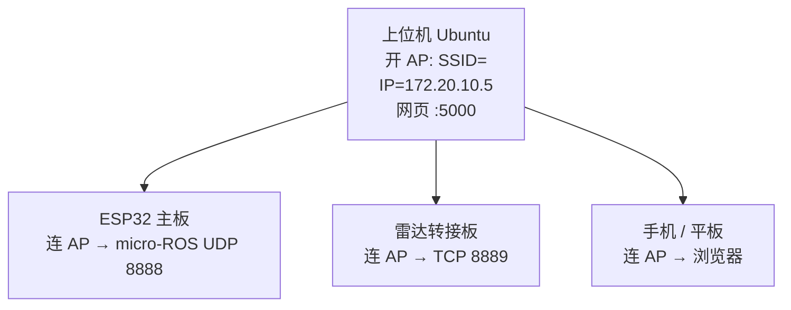
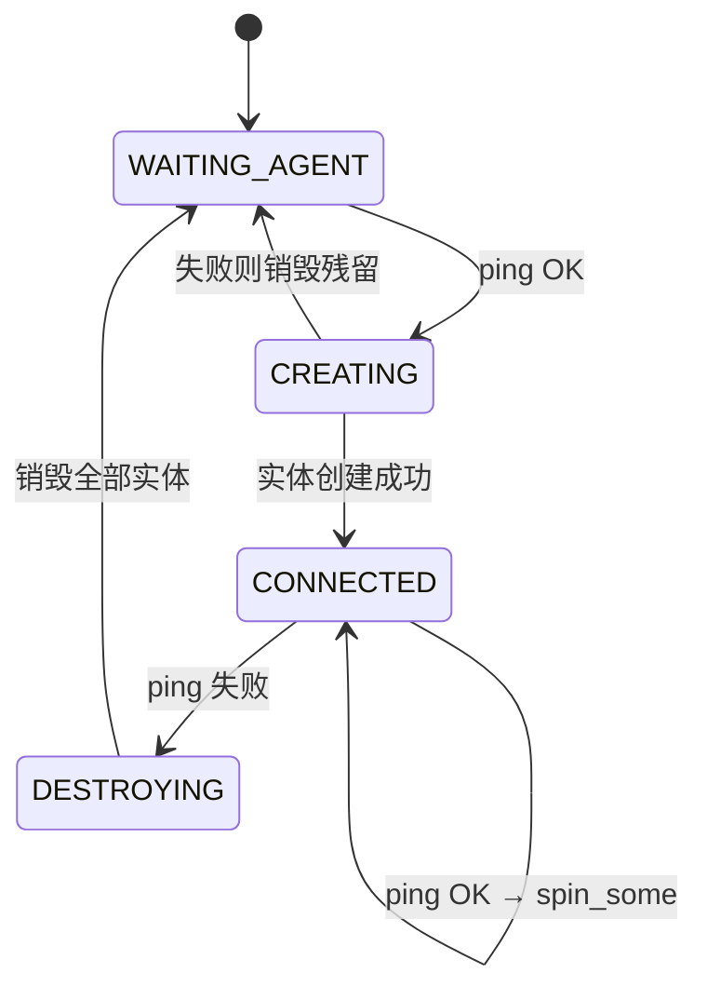

# 上下位机长连接改造

> 目标：**上位机断连后，下位机自动重连，不再需要重启芯片。**
> 日期：2026-10-31

---

## 一、最终架构



### 为什么 SSID 用 `<WIFI_SSID>`

ESP32 固件里硬编码：

```c
#define WIFI_SSID           "<WIFI_SSID>"
#define WIFI_PASSWORD       "<WIFI_PASSWORD>"
#define MICROROS_AGENT_IP   "172.20.10.5"
#define MICROROS_AGENT_PORT 8888
```

让上位机开一个**同名热点、用同一个 IP**，ESP32 固件业务逻辑**一行都不用改**。

> 注意：`<WIFI_SSID>` 原本是手机热点名。请确保**手机不要再开同名热点**，
> 否则 ESP32 可能连到手机上而接不上 agent。
> 稳定后可改成 `fishbot-ap`，代价是 ESP32 要重烧一次（改两行宏）。

---

## 二、为什么之前「上位机断连就接不上」

### ESP32 侧（4 个缺口）

| # | 问题 | 位置 |
|---|---|---|
| 1 | 传输层只初始化一次 | `set_microros_wifi_transports()` |
| 2 | `rclc_executor_spin()` 永不返回，没有退出口 | 原 `microros_task` 末尾 |
| 3 | **全文件 0 处 `rmw_uros_ping_agent`** | — |
| 4 | `rcl_publish` 失败只打印日志，不触发恢复 | `timer_callback` |

### 雷达转接板侧（3 个 bug）

| # | 问题 | 后果 |
|---|---|---|
| 5 | `nvs_write_string` 的 `commit`/`close` 是死代码 | **配置掉电即丢** |
| 6 | `recv()` 返回 0（对端 FIN）时不置断连 | **永远不重连** |
| 7 | `connect()` 阻塞无超时 | 重连任务被拖死 |

---

## 三、已做的改动

### 3.1 ESP32 主板：四态重连状态机



**关键设计：不重启芯片。**

`Kinematics::update_odom()` 是纯累加、无持久化：

```cpp
odom.x += delta_distance * cos(odom.angle);
odom.y += delta_distance * sin(odom.angle);
odom.angle += odom.angular_speed * dt_s;
```

芯片一重启 `odom` 归零 → 上位机 `odom→base_footprint` 瞬间跳变 →
EKF 崩 → 导航定位失效。所以**只重建 ROS 实体**，运动学状态、PID、
电机全部保留。

仅在连续重建失败 50 次（约 25 秒）这种极端情况才 fallback 到重启。

**探活节奏**：`CONNECTED` 态每 500ms 一次，`100ms × 3 attempts`。
不要每圈都 ping —— agent 不在时单次 ping 最长阻塞 `timeout_ms`，
太频繁会把 `timer_callback`（20ms，负责发 `/odom`、`/imu_raw`）挤掉。

**其他修复**：

- `set_microros_wifi_transports()` 内部是 `WiFi.begin + 无超时死等`，
  只能调一次，绝不进重连循环
- WiFi 首次连接超时 60s→30s，失败**不再 `ESP.restart()`**
  （原来热点没开就无限重启，每次重启都清 odom）
- 新增 `ros_wifi_ensure()`：WiFi 掉线按 5s 间隔重连
- `while(!rmw_uros_epoch_synchronized())` 无上限死等 → 最多试 20 次

### 3.2 雷达转接板：3 个 bug

**① `nvs_write_string` 死代码**

```c
// 修改前
if (nvs_set_str(...) != ESP_OK) return 0;
return -1;                    // ← 无条件返回
nvs_commit(mHandleNvs);       // ← 永远执行不到
nvs_close(mHandleNvs);        // ← 永远执行不到
```

配置只写进内存缓存、从未落盘，`nvs_handle` 还泄漏。
返回值语义还与 `nvs_read_string` 相反（成功 -1 / 失败 0）。

**② `recv()` 返回 0 不触发重连**

```c
// 修改前：返回 0 或负数什么都不做
if (rx_bytes_len > 0) { protocol_package_->size = rx_bytes_len; }
return rx_bytes_len;
```

上位机正常关闭会发 FIN → `recv` 返回 0 → `is_tcp_client_init_` 仍为
`true` → 重连任务永不唤醒。

修改后区分三种情况：

| `recv` 返回 | 含义 | 处理 |
|---|---|---|
| `== 0` | 对端 FIN | 置断连 + 关闭 socket |
| `< 0` 且非 `EAGAIN` | 真实错误 | 置断连 + 关闭 socket |
| `< 0` 且 `EAGAIN` | `SO_RCVTIMEO` 空闲超时 | **正常**，不动作 |

**③ `connect()` 加超时**

非阻塞 `connect` + `select` 3 秒超时；连上后恢复阻塞模式并给
`recv` 设 1 秒 `SO_RCVTIMEO`。

---

## 四、编译

### ESP32 主板

```bash
cd fishbot_motion_control
pio run                    # 编译
pio run -t upload          # 烧录
```

实测：RAM 33.9% / Flash 68.3%

### 雷达转接板（ESP8266）

**首次需搭环境**（脚本头部有完整步骤）：

```bash
mkdir -p ~/esp8266_build && cd ~/esp8266_build

# SDK —— 必须 --recursive，否则缺 4 个子模块，编译报
#      "ERROR: esp-idf must be cloned from git to work"
git clone --recursive --depth 1 -b release/v3.4 \
    https://github.com/espressif/ESP8266_RTOS_SDK.git

# 工具链
curl -LO https://dl.espressif.com/dl/xtensa-lx106-elf-gcc8_4_0-esp-2020r3-linux-amd64.tar.gz
tar xzf xtensa-lx106-elf-gcc8_4_0-esp-2020r3-linux-amd64.tar.gz

# venv（SDK 的 make 构建系统要求有个叫 `python` 的可执行文件，
#      我们是 python3；venv 提供即可，脚本本身兼容 py3）
python3 -m venv venv
./venv/bin/pip install -r ESP8266_RTOS_SDK/requirements.txt
```

**编译**：

```bash
cd fishbot_laser_control
./build.sh              # 编译
./build.sh flash        # 烧录（默认 /dev/ttyUSB0）
PORT=/dev/ttyUSB1 ./build.sh flash
```

产物：`build/uart2udp.bin` (462K) + bootloader + 分区表

---

## 五、操作流程

### 5.1 上位机切到 AP 模式

```bash
cd fishbot_ws
./tools/ap_mode.sh on       # 开热点（会断外网）
./tools/ap_mode.sh status   # 看已连设备
./tools/ap_mode.sh off      # 切回原来的 WiFi
```

AP 配置（已创建，`autoconnect no` 不会自动激活）：

| 项 | 值 |
|---|---|
| SSID | `<WIFI_SSID>` |
| 密码 | `<WIFI_PASSWORD>` |
| 频段 | 2.4GHz (`band bg`) |
| 信道 | 1 |
| 本机 IP | `172.20.10.5/24` |
| DHCP | `ipv4.method shared`（自动跑 dnsmasq） |

### 5.2 手机看网页

手机连 `<WIFI_SSID>`（密码同上），浏览器打开：

```
http://172.20.10.5:5000
```

> `web_controller.py` 绑的是 `0.0.0.0:5000`，所以手机能访问。

### 5.3 雷达转接板配一次网

串口 **115200**，**雷达需断电**才能进配置模式（固件靠"启动时
10 次读串口都没数据"进入配置模式）：

```
$wifi_ssid=<WIFI_SSID>
$wifi_pswd=<WIFI_PASSWORD>
$server_ip=172.20.10.5
$server_port=tcp:8889
$command=restart
```

验证是否真的落盘（NVS bug 已修，这里应该能读到）：

```
$command=read_config
```

### 5.4 给两块板绑固定 IP（可选但推荐）

先切 AP 模式让板子连上，`./tools/ap_mode.sh status` 查 MAC，然后：

```bash
sudo mkdir -p /etc/NetworkManager/dnsmasq-shared.d
sudo tee /etc/NetworkManager/dnsmasq-shared.d/fishbot.conf <<EOF
dhcp-host=AA:BB:CC:DD:EE:01,172.20.10.10   # ESP32 主板
dhcp-host=AA:BB:CC:DD:EE:02,172.20.10.11   # 雷达转接板
EOF
sudo systemctl restart NetworkManager
```

板子侧仍从 DHCP 拿地址，只是每次都是同一个 —— **板子不用改任何配置**。

---

## 六、代价与注意

| 项 | 说明 |
|---|---|
| **开 AP 期间没外网** | 单网卡不能 STA+AP 且必须同信道，ESP 只支持 2.4G |
| **AI 走本地模型** | `fishbot-qwen:3b` / `qwen2.5:3b` 已在 Ollama 中就绪 |
| **手机蜂窝数据仍可用** | 系统提示"无互联网"但保持连接 |
| **想做 STA+AP 双通** | 需接 USB 有线网卡（本机有 `enx2ec2534f9850`）走外网 |
| **手机别开同名热点** | 会抢 ESP32 的连接 |

---

## 七、验证清单

烧录后按顺序确认：

- [ ] 上位机 `./tools/ap_mode.sh on` → `status` 看到 AP 激活
- [ ] ESP32 串口出现 `WiFi 已连接, ESP32 IP=...`
- [ ] 串口出现 `[microROS] 首次连接成功`
- [ ] `ros2 topic hz /odom` 有数据（约 50Hz）
- [ ] **核心测试**：重启 `micro_ros_agent`，观察串口
      - 应出现 `[microROS] Agent 失联，销毁实体准备重连`
      - 然后 `[microROS] 重连成功（第 1 次恢复）`
      - **不应重启芯片，odom 不应归零**
- [ ] 雷达：`$command=read_config` 能读到配的值（验证 NVS 修复）
- [ ] 雷达：重启上位机 TCP 桥接，雷达应自动重连
      （日志出现 `TCP connected to 172.20.10.5:8889`）
- [ ] `ros2 topic hz /scan` 恢复约 7Hz

---

## 八、已知遗留

1. **ESP32 的 `<WIFI_SSID>`/IP 仍硬编码** —— 换网络要重烧。彻底解决需把
   SSID/IP 存 NVS + 首次配网，工作量较大，暂未做。
2. **雷达转接板无法"自动跟随"上位机连的 WiFi** —— 物理上不可能
   （要先连上才能知道；且 WPA2 密码无法从空中获取）。
   本方案用「上位机提供恒定网络」绕开了这个限制。
3. **2 处原固件 `rcl_publish` 返回值未检查**（电池发布处），
   非本次改动引入，未处理。
