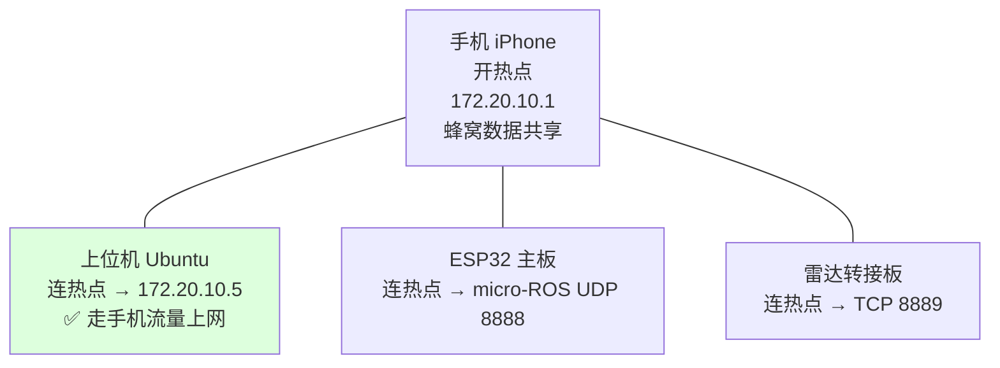

# 上下位机网络方案（最终版）

> 结论：**手机开热点，所有设备连它。** 这是最简单也最可靠的方案。
> 日期：2026-10-31

---

## 一、为什么选这个方案

### 试过的方案与结论

| 方案 | 结果 | 原因 |
|---|---|---|
| 上位机开 AP（`fishbot-ap`） | ❌ 上位机断网 | NM 单 device 同时只能 1 个 active connection |
| 上位机 STA+AP 并发（虚拟接口 `ap0`） | ❌ 走不通 | `iw dev set type ap` 强制要求 `hostapd`，而 NM 的 `shared` 模式不用 hostapd；`ip link set ap0 up` 报 `Device or resource busy` |
| **手机开热点** ⭐ | ✅ **最优** | 上位机只当 STA，无并发问题 |

> 内核其实声明支持并发（`total <= 3, #channels <= 2`），
> 但软件栈（NetworkManager）无法把 AP 放到第二个接口上。

### 最终架构



**关键优势**：

1. 上位机只当 STA → 无 iwlwifi 并发限制
2. 手机蜂窝数据共享 → **上位机能上网，AI 助手全程在线**
3. 手机本身就在热点上 → 直接浏览器开 `http://172.20.10.5:5000`
4. 这正是固件的原始设计（`WIFI_SSID "<WIFI_SSID>"` + `172.20.10.x` 网段）→ **零固件改动**

---

## 二、已完成的配置

### 上位机：`<WIFI_SSID>` 连接固定 IP

固件硬编码 `MICROROS_AGENT_IP "172.20.10.5"`，所以上位机**必须**是 `.5`。
iPhone 热点 DHCP 池是 `172.20.10.2 ~ .14`，不保证给 `.5`，因此固定：

```bash
nmcli con modify <WIFI_SSID> \
  ipv4.method manual \
  ipv4.addresses 172.20.10.5/28 \
  ipv4.gateway 172.20.10.1 \
  ipv4.dns "172.20.10.1 223.5.5.5"
```

当前状态：

| 项 | 值 |
|---|---|
| SSID | `<WIFI_SSID>` |
| IP | `172.20.10.5/28`（固定） |
| 网关 | `172.20.10.1`（手机） |
| DNS | `172.20.10.1`, `223.5.5.5` |
| autoconnect | `yes`（热点一开就自动连） |
| 密码 | 已保存 |

### 两块下位机

| 板子 | 配置 | 状态 |
|---|---|---|
| ESP32 主板 | `WIFI_SSID "<WIFI_SSID>"` / agent `172.20.10.5:8888` | 固件硬编码，已烧录 |
| 雷达转接板 | `wifi_ssid=<WIFI_SSID>` / `server_ip=172.20.10.5` / `tcp:8889` | NVS 已配，已烧录 |

---

## 三、日常使用流程

### 3.1 开机

1. **手机开热点**，SSID 必须叫 `<WIFI_SSID>`，密码 `<WIFI_PASSWORD>`
   - iPhone：设置 → 个人热点 → 打开"允许其他人加入"
   - ⚠️ 建议打开**"最大兼容性"**（走 2.4GHz，ESP 才连得上）
2. **上位机自动连上**（`autoconnect yes`），3~5 秒后拿到 `172.20.10.5`
3. **小车通电**，两块板自动连热点
4. 启动 bringup + navigation2 + web_controller
5. **手机浏览器**打开 `http://172.20.10.5:5000`

### 3.2 验证

```bash
cd ~/bishe_ws/bishe-main/fishbot_ws
./tools/verify_link.sh
```

或者手动查：

```bash
# 1. 上位机是否拿到固定 IP
ip -4 addr show wlp0s20f3 | grep inet
# 应显示 172.20.10.5/28

# 2. 能否上网（走手机流量）
curl -s -o /dev/null -w "%{http_code}\n" https://www.baidu.com

# 3. 两块板是否连上
ip neigh show dev wlp0s20f3 | grep 172.20.10
# 应看到 .2 / .3 等，MAC 前缀 14:08:08（ESP32）/ 60:01:94（雷达板）

# 4. 话题是否有数据
ros2 topic hz /odom      # ~50Hz
ros2 topic hz /scan      # ~7Hz
ros2 topic hz /imu_raw   # ~50Hz
```

---

## 四、注意事项

| 项 | 说明 |
|---|---|
| **手机必须是 iPhone** | `172.20.10.x` 是 iPhone 热点专属网段；安卓是 `192.168.43.x`，会破坏现有配置 |
| **手机要一直开热点** | 费电、发热，建议插着充电器 |
| **设备数上限** | iPhone 热点一般支持 5 台。上位机 + ESP32 + 雷达板 = 3 台，够用 |
| **手机不要走开** | 离开范围全部失联 |
| **2.4GHz** | ESP 只支持 2.4G，务必开"最大兼容性"（否则 iPhone 可能用 5G 开热点） |
| **不再需要 `fishbot-ap`** | 该配置保留但不使用，可随时 `nmcli con delete fishbot-ap` |

### 2.4G 带宽够用吗

实测数据：

| 项 | 需求 |
|---|---|
| 雷达 TCP 原始流 | 48 kbps |
| ESP32 micro-ROS（/odom+/imu_raw+/cmd_vel） | 550 kbps |
| **合计** | **0.60 Mbps** |

2.4G 链路 25+ Mbps，占用率约 2.3%，**完全够用**。

> 注意：手机热点上网和机器人通信共享同一个 2.4G 链路（手机侧也是单射频）。
> 如果我大量下载文件，理论上会挤占小车带宽。但 0.6Mbps 对 25Mbps 来说余量极大。

---

## 五、故障排查

### 上位机没拿到 172.20.10.5

```bash
# 检查是否连上
nmcli -t -f DEVICE,STATE,CONNECTION device | grep wlp0s20f3
# 看看配置对不对
nmcli con show <WIFI_SSID> | grep -E "ipv4.addresses|ipv4.method"
```

### ESP32 连不上

串口看（115200）：

```
I (xxx) mwifi: AP not found        → 热点没开 / SSID 不对 / 用了 5GHz
WiFi 暂未连上(status=1)，进入重连循环（不重启）  → 正常重试中
[microROS] Agent 在线，创建实体    → 连上了
```

### 雷达板连不上

串口看（115200）：

```
I (xxx) tcp_client: Socket created, connecting to 172.20.10.5:8889
→ 反复出现    = 连不上上位机（检查上位机 IP 是否 .5、8889 端口是否监听）
→ 只出现一次  = 已连上
```

### 上位机没网（手机流量没生效）

```bash
# 1. 能否 ping 通网关
ping -c2 172.20.10.1
# 2. DNS 是否可用
nslookup www.baidu.com
# 3. 换 DNS 测试
curl --dns-servers 223.5.5.5 -s -o /dev/null -w "%{http_code}\n" https://www.baidu.com
```

---

## 六、相关文件

| 文件 | 说明 |
|---|---|
| `tools/verify_link.sh` | 连通性自检，输出 `/tmp/fishbot_link_report.txt` |
| `tools/ap_mode.sh` | 上位机开 AP 的脚本（**本方案不使用**，保留备用） |
| `docs/long_connection.md` | 长连接改造（固件重连状态机、NVS/TCP bug 修复） |
