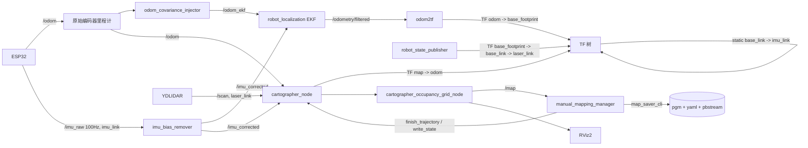

# FishBot 手动建图（Cartographer 2D + IMU）

本功能在既有 `fishbot_bringup` 包内实现，不新建独立包，也不改动旧的
`cartographer_slam.launch.py` / `fishbot_cartographer.lua`。

## 1. 文件清单

| 文件 | 作用 |
|---|---|
| `config/fishbot_cartographer_manual.lua` | 手动建图专用 Cartographer 配置（IMU 融合） |
| `launch/manual_mapping.launch.py` | 一键启动：底盘 bringup + IMU/EKF + Cartographer + 存图服务 + RViz |
| `fishbot_bringup/manual_mapping_manager.py` | 建图收尾状态机：`finish_trajectory` → 等最终 `/map` → 存 pgm/yaml/pbstream |
| `../custom_interfaces/srv/SaveMap.srv` | 存图请求/响应接口 |
| `fishbot_bringup/save_map.py` | 旧 CLI 存图工具（本次修复默认路径与非交互覆盖行为） |

## 2. 数据流



关键口径与实机 `stemm_cartographer_exploration` 包一致：

- Cartographer 使用**原始 `/odom`** + `/imu_corrected` + `/scan`；
- EKF 只负责 `odom -> base_footprint` 的 TF，不把 `/odometry/filtered` 喂给
  Cartographer，避免同一份陀螺信息被重复计入；
- `imu_bias_remover` 只修正陀螺 Z 轴零偏，`/imu_corrected` 保留
  `imu_link` 帧。

## 3. 启动

```bash
cd ~/bishe_ws/bishe-main/fishbot_ws
source /opt/ros/humble/setup.bash
source install/setup.bash

# 一键启动（含底盘 bringup；语音被强制关闭）
ros2 launch fishbot_bringup manual_mapping.launch.py
```

常用组合：

```bash
# 底盘已由网页/Qt/其他 launch 启动，只起建图链路
ros2 launch fishbot_bringup manual_mapping.launch.py include_bringup:=false

# 已运行 navigation2.launch.py（里面已有 EKF + imu_bias_remover），避免重复启动
ros2 launch fishbot_bringup manual_mapping.launch.py \
    include_bringup:=false start_ekf:=false

# 远程/无显示器
ros2 launch fishbot_bringup manual_mapping.launch.py use_rviz:=false

# 调整 IMU 安装位置（默认与 base_link 重合）
ros2 launch fishbot_bringup manual_mapping.launch.py \
    imu_x:=0.0 imu_y:=0.0 imu_z:=0.05
```

启动后：

1. 保持机器人**静止 3~5 s**，等 `imu_bias_remover` 打出“陀螺偏置初始标定完成”；
2. 用 Web 摇杆 / Qt 手动控制 / 键盘遥控驱动机器人；
3. RViz 中确认 `/map` 在增长、`map -> odom -> base_footprint` TF 正常；
4. 建图结束后调用存图服务。

> 本 launch **不启动任何遥控节点，也不会自动发送 `/cmd_vel`**。语音节点被
> 强制 `enable_voice:=false`，避免建图过程中喊一句话就动车。

## 4. 存图 / 丢弃 / 状态

```bash
# 存图：name 为空则自动生成 manual_<YYYYmmdd_HHMMSS>
ros2 service call /manual_mapping/save_map \
  custom_interfaces/srv/SaveMap \
  "{name: 'room1', directory: '', overwrite: false, save_pbstream: true}"

# 丢弃本次建图（调用 finish_trajectory，不保存文件）
ros2 service call /manual_mapping/discard_map std_srvs/srv/Trigger "{}"

# 查询状态（message 是 JSON，含地图尺寸/占用格/空闲格/未知格）
ros2 service call /manual_mapping/get_status std_srvs/srv/Trigger "{}"

# 1 Hz 状态话题
ros2 topic echo /manual_mapping/status
```

存图流程：

1. 调用 Cartographer `/finish_trajectory`（`trajectory_id=0`）；
2. 等待 finish 之后的新 `/map`（默认最多 20 s），再稳定 3 s；
3. 用 `nav2_map_server map_saver_cli` 在目标目录的临时子目录写出 pgm/yaml；
   随后把 yaml 的 `image:` 字段改写为**同目录文件名**（map_saver 会写入
   调用时传入的临时绝对路径，不改写会导致地图加载失败）；
4. 调用 Cartographer `/write_state` 写 `.pbstream`；
5. `os.replace` 原子替换到最终路径，**yaml 最后落盘**作为完整标记；
6. 失败时返回明确原因，不会留下半套文件（临时目录自动清理）；
   `.pbstream` 写失败只降级为「仅保存 pgm/yaml」，不阻断主流程。

默认保存目录：`<workspace>/src/fishbot_navigation2/maps/`。默认文件名：
`manual_YYYYmmdd_HHMMSS`。

```bash
# 用新地图启动导航（需先关闭建图 launch）
ros2 launch fishbot_navigation2 navigation2.launch.py \
    map:=$HOME/bishe_ws/bishe-main/fishbot_ws/src/fishbot_navigation2/maps/room1.yaml
```

> `.pbstream` 可用于后续纯定位 / 地图二次优化；当前导航仍使用 pgm+yaml。

## 5. 启动自检

管理节点在启动后 `preflight_delay_sec`（默认 20 s，需等雷达 5 s 延迟启动和
micro-ROS 连接）会做一次**只读**自检，输出：

- `/scan`、`/imu_corrected`、`/odom`、`/odometry/filtered` 四个话题的收帧计数；
- TF `odom -> base_footprint`、`base_link -> imu_link` 是否存在；
- 是否已收到第一帧 `/map`。

对应常见故障会直接给出可执行提示（雷达未 activate、ESP32 未连上、EKF 未运行、
IMU TF 缺失等）。自检**不发布任何运动指令**，也不影响建图。

```bash
# 关闭自检
ros2 launch fishbot_bringup manual_mapping.launch.py preflight_check:=false
```

## 6. 关键参数

| Launch 参数 | 默认 | 说明 |
|---|---|---|
| `include_bringup` | `true` | 是否启动 `bringup.launch.py` |
| `start_ekf` | 跟随 `include_bringup` | 是否启动 `imu_bias_remover` + EKF |
| `publish_imu_tf` | `true` | 是否发布 `base_link -> imu_link` |
| `configuration_basename` | `fishbot_cartographer_manual.lua` | 建图 lua |
| `resolution` | `0.05` | 栅格分辨率 |
| `publish_period_sec` | `1.0` | `/map` 发布周期 |
| `map_dir` | 空 | 空则用工作空间 `src/fishbot_navigation2/maps` |
| `final_map_timeout_sec` | `20.0` | finish 后等最终地图的上限 |
| `final_map_settle_sec` | `3.0` | 最终地图到位后的稳定时间 |
| `save_pbstream` | `true` | 是否保存 `.pbstream` |
| `overwrite` | `false` | 是否允许覆盖同名地图 |
| `preflight_check` | `true` | 启动后只读自检 |
| `preflight_delay_sec` | `20.0` | 自检延时 |
| `service_wait_timeout_sec` | `5.0` | 等待 Cartographer 服务出现的超时 |

## 7. Lua 参数与参考实现的对应关系

参考源（用户指定）：
`/home/user/wheeltec_ros2/src/stemm_cartographer_exploration/config/stemm_cartographer_2d.lua`
（`/home/user/stemm_exploration_sim_ws` 内没有 lua；同份源码在
`/home/user/stemm_explore_ws`）。

已移植/对齐的参数：

| 参数 | 参考值 | 本配置 | 理由 |
|---|---|---|---|
| `tracking_frame` | `gyro_link` | `imu_link` | 本车 IMU 帧名 |
| `published_frame` | `odom_combined` | `odom` | 本车 `odom2tf` 发布 `odom` |
| `TRAJECTORY_BUILDER_2D.use_imu_data` | `true` | `true` | 已确认 IMU 可用 |
| `real_time_correlative_scan_matcher` 搜索窗 | 0.08 m / 6° | 同 | 限制 CPU 占用 |
| `motion_filter` | 0.5 s / 0.08 m / 1° | 同 | 慢速手动推车也够密 |
| `submaps.num_range_data` | 90 | 同 | — |
| `hit_probability` / `miss_probability` | 0.60 / 0.495 | 同 | 障碍更耐久 |
| `POSE_GRAPH.optimize_every_n_nodes` | 90 | 同 | — |
| `constraint_builder.sampling_ratio` | 0.08 | 同 | 避免旧配置 0.5 的高开销 |
| `global_sampling_ratio` | 0.003 | 同 | 旧配置 0.01 偏重 |
| `global_constraint_search_after_n_seconds` | 15.0 | 同 | — |
| `MAP_BUILDER.num_background_threads` | 2 | 同 | — |
| `max_range` | 12.0 | 8.0 | YDLIDAR 室内按 8 m 截断 |
| `rangefinder_sampling_ratio` | 0.7 | 1.0 | 本车雷达仅 5 Hz，不抽帧 |

**没有照搬**的部分：Wheeltec 专用帧名、12 m 量程、TF 由外部 EKF 负责的
`odom_combined` 命名，以及自主探索 / Nav2 / 返航相关逻辑。

## 8. 约束与排障

**必须互斥**：Cartographer 与 AMCL/Nav2 都会发布 `map -> odom`。建图前请关闭
导航；管理节点启动 3 s 后会检查 `amcl/map_server/controller_server/...` 并打印
ERROR 提示。

**IMU 相关**

- 报 `"imu_link" ... does not exist`：`publish_imu_tf` 被设为 false，或
  `static_transform_publisher` 未启动。IMU 融合建图必须有
  `base_link -> imu_link`。
- 报 `Failed to compute extrapolator's transform`：通常是 `odom ->
  base_footprint` 缺失。检查 EKF 是否运行、`odom2tf` 是否收到
  `/odometry/filtered`。
- IMU 零偏未校准：启动后保持静止 3~5 s；日志出现“陀螺偏置初始标定完成”后再
  开始推车。
- 若 IMU 实际安装方向与 `base_link` 不一致，用 `imu_roll/pitch/yaw` 调整；
  MPU6050 的 Z 轴应朝上，否则重力对齐会出错。

**存图相关**

- `map_saver_cli` 失败：确认 `ros2 pkg prefix nav2_map_server` 正常，且
  `/map` 仍在发布。
- `write_state 不可用`：`cartographer_node` 未运行或已被关闭；可先不带
  `save_pbstream` 存 pgm/yaml，再排查。
- `finish_trajectory 失败`：管理节点会降级为“保存缓存地图”，并在响应
  message 里说明；这种地图不是最终优化结果，建议重跑。
- 同名文件：默认拒绝覆盖；需要覆盖时传 `overwrite: true`。

## 9. 验证记录（2026-10-30）

已做（**全部离线，未连接实车/未发布任何运动指令**）：

- `colcon build --packages-select custom_interfaces fishbot_bringup --symlink-install` 通过；
- `ros2 interface show custom_interfaces/srv/SaveMap` 正常；
- `python3 -m py_compile` 通过；
- 单独启动管理节点：`/manual_mapping/get_status` 返回
  `{"state": "waiting_for_map", ...}`；无 `/map` 时 `discard_map` 拒绝，符合预期；
- `ros2 launch ... include_bringup:=false use_rviz:=false` 干跑：静态 TF、
  Cartographer、occupancy grid、管理节点均正常拉起，`start_ekf` 默认跟随
  `include_bringup=false`，没有误启动 EKF；
- 用 Cartographer 节点直接加载新 lua：解析成功、`Added trajectory with ID '0'`；
- 用本地合成的 `/map`（独立 `ROS_DOMAIN_ID`，无任何底盘话题）验证存图全链路：
  - pgm 为合法 `P5`，尺寸/分辨率与输入一致；
  - yaml 的 `image:` 已改写为相对文件名；
  - 临时目录无残留；
  - 无 Cartographer 时：`finish_trajectory`/`write_state` 缺失会被记录并
    **降级为仅保存 pgm/yaml**，仍返回 success 与真实路径；
  - 同名文件 + `overwrite: false` → 拒绝并提示；
  - 空 `name` → 自动生成 `manual_YYYYmmdd_HHMMSS`；
  - `name: '../../etc/passwd'` → 被净化为 `etc_passwd`，不越出目标目录；
  - 已保存后再次调用返回幂等结果，已保存后 `discard_map` 拒绝；
  - 状态话题 `/manual_mapping/status` 输出 JSON，含地图格子统计；
- 自检在无传感器环境下按预期报出 4 个话题 0 帧、`odom -> base_footprint`
  缺失，并确认 `base_link -> imu_link` 静态 TF 正常。

**未做（需要实车，本次环境无法验证）**：真实雷达/IMU 数据下的建图质量、
`finish_trajectory` 后最终 `/map` 的实际到达时序、`write_state` 真实落盘、
生成地图在 Nav2 中的可用性、IMU 融合相对纯激光的实际提升。这些请按第 3、4 节
在实车上验证。

## 10. 后续可扩展

- Web/Qt 增加“开始建图 / 保存地图 / 丢弃”按钮，直接调本节点的三个服务；
- 建图前自动检查并关闭 Nav2（当前只打印 ERROR 提示）；
- 多轨迹建图（`start_trajectory` + 轨迹选择）与地图拼接；
- 存图后自动做地图质量检查（占用格连通性、未知区域比例）。
