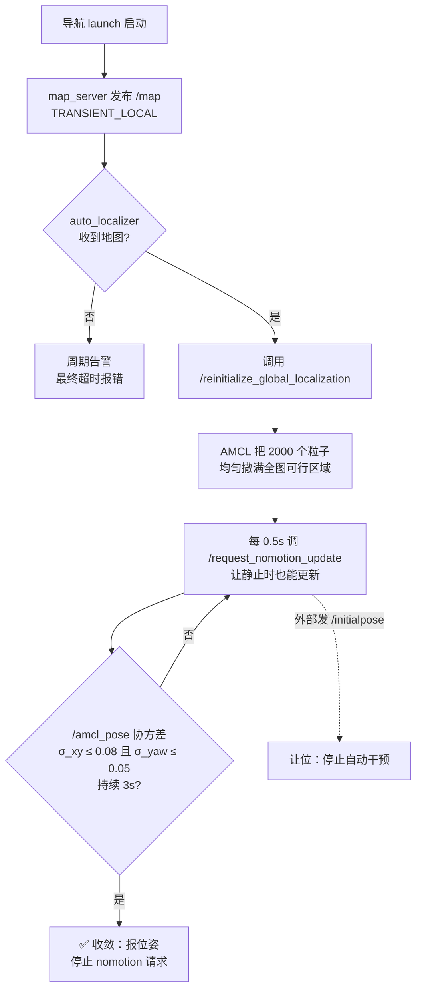

# AMCL 自动全局定位（navigation 启动即自行收敛）

## 1. 为什么改

原先的导航流程默认「小车就在地图原点、朝向 0°」。

```
毛病：
  地图是人工建的，原点取决于建图时小车启动的位置；
  导航时的起点只要和建图起点差 20cm，AMCL 就会被喂一个错的先验，
  粒子云从错误位置开始，要么收敛到错的地方，要么彻底发散。
  于是每次都得在 RViz 手点 2D Pose Estimate。
```

现在的流程：**导航一起来，AMCL 自己把粒子云撒满整张地图，靠激光匹配自动收敛**。
不需要人工点、也不需要「车总在同一点启动」这个隐含假设。

参考实现：`/home/user/wheeltec_ros2/src/wheeltec_robot_nav2`（`set_initial_pose: False` +
`nomotion_update_period_sec: 0.5` + 全局定位 bootstrap）。

## 2. 原理



关键点：

- **粒子数**：`max_particles: 2000` / `min_particles: 500`。全局定位初期粒子要铺满整图，
  粒子太少根本覆盖不到真实位置。
- **静止更新**：AMCL 默认只在机器人移动超过 `update_min_d/a` 时才更新粒子。
  小车不动 → 永远不收敛。所以自动定位期间每 0.5s 主动调 `/request_nomotion_update`。
- **让位**：一旦外部（RViz 的 2D Pose Estimate / 巡逻模块 / 网页控制器）发了
  `/initialpose`，本节点立刻停止，不跟人抢。自己发的先验会被自环过滤掉，不算外部。

## 3. 用法

```bash
# 默认：自动全局定位开启，用 fishbot_map1
ros2 launch fishbot_navigation2 navigation2.launch.py

# 换地图
ros2 launch fishbot_navigation2 navigation2.launch.py \
    map:=$HOME/bishe_ws/bishe-main/fishbot_ws/src/fishbot_navigation2/maps/room1.yaml

# 想要原来的行为（不自动定位，靠自己点 2D Pose Estimate）
ros2 launch fishbot_navigation2 navigation2.launch.py auto_localization:=false

# 车每次都在同一点启动 → 不发全局散布，直接给粗先验（更稳、更快）
ros2 launch fishbot_navigation2 navigation2.launch.py \
    auto_localization_use_prior:=true
# 此时先验坐标在 nav2_params.yaml 的 amcl.initial_pose 里改
```

## 4. launch 参数

| 参数 | 默认 | 说明 |
|---|---|---|
| `auto_localization` | `true` | 关掉后本节点空转，AMCL 行为与改造前一致 |
| `auto_localization_use_prior` | `false` | `true` = 不用全局散布，改发 `initial_pose` 粗先验 |
| `auto_localization_delay_sec` | `3.0` | 启动后等多久开始（给 nav2 节点留启动时间） |
| `auto_localization_timeout_sec` | `120.0` | 超时后打错误日志并停止干预（不会中断导航） |
| `map` | `maps/fishbot_map1.yaml` | 地图路径 |
| `start_odom_helpers` | `false` | 是否由导航 launch 启动 `urdf2tf`/`odom2tf`/协方差注入。默认 `false`，因为实际用法是先跑 bringup，它已经起了这些节点 |

> **为什么 `start_odom_helpers` 默认 false**
> 两个 launch 都起会让同一组节点存在两份：
> - 静态 TF 被两个进程重复发布 → `TF_REPEATED_DATA` 刷屏
> - `/odom_ekf` 被两个注入节点重复发布 → EKF 吃到重复输入
>
> 只有当你要**单独调试导航**（不起 bringup）时，才需要置 `true`。

## 4.1 桥接层参数（`tcpserver.py`）

| 参数 | 默认 | 说明 |
|---|---|---|
| `tcp_port` | `8889` | 等雷达转接板连入的端口 |
| `serial_port` | `/tmp/laserport` | 创建的 pty 符号链接（本项目用 `/tmp/tty_laser`）|
| `read_chunk` | `4096` | 单次读取上限 |
| `idle_disconnect_sec` | `5.0` | 雷达方向多久无字节就断开逼重连。**这是假死恢复机制，不要设为 0** |
| `stats_period_sec` | `30.0` | 桥接统计日志周期，`0` = 不打印 |
| `tcp_user_timeout_ms` | `15000` | 对端不 ACK 时让写操作快速失败 |
| `max_buffer_bytes` | `262144` | 单向积压上限，超了丢最旧的（流式数据旧字节无意义）|

## 5. 节点参数（`auto_localizer.py`）

| 参数 | 默认 | 说明 |
|---|---|---|
| `auto_global_localization` | `true` | 与 launch 的 `auto_localization` 对应 |
| `use_initial_pose_prior` | `false` | 走粗先验而非全局散布 |
| `initial_pose_x/y/yaw` | `0.0` | 粗先验位姿（仅 prior 模式用） |
| `initial_pose_cov_xy` | `0.25` | 粗先验位置方差（m²）。越大越不信任先验 |
| `initial_pose_cov_yaw` | `0.0685` | 粗先验朝r方差（rad²），约 15° |
| `startup_delay_sec` | `3.0` | 启动延时 |
| `nomotion_update_period_sec` | `0.5` | 静止更新周期 |
| `tick_period_sec` | `0.5` | 主循环周期 |
| `timeout_sec` | `120.0` | 收敛超时 |
| `log_period_sec` | `10.0` | 进度日志间隔 |
| `converge_cov_xy` | `0.08` | 收敛判据：σ_xy 阈值（m） |
| `converge_cov_yaw` | `0.05` | 收敛判据：σ_yaw 阈值（rad） |
| `converge_hold_sec` | `3.0` | 需连续满足多久才算收敛（防抖动） |
| `stop_nomotion_after_converge` | `true` | 收敛后停止 nomotion 请求 |
| `defer_on_external_initial_pose` | `true` | 外部设位姿后让位 |
| `map_topic` | `/map` | |
| `amcl_pose_topic` | `/amcl_pose` | |
| `initial_pose_topic` | `/initialpose` | |
| `scan_topic` | `/scan` | 用于激光健康监测 |
| `scan_stale_sec` | `3.0` | 超过这么久没激光就判为「激光已停」 |
| `global_localization_service` | `/reinitialize_global_localization` | |
| `nomotion_update_service` | `/request_nomotion_update` | |

## 6. 怎么判断收敛了

终端里会看到：

```
[auto_localizer]: 收到地图：249x230 @ 0.050 m/px, 覆盖 12.5m x 11.5m, 原点(-7.98, -7.62)
[auto_localizer]: 调用 /reinitialize_global_localization：让 AMCL 把粒子云撒满整张地图
[auto_localizer]: 全局定位已触发。请缓慢移动/旋转小车（或原地转动）...
[auto_localizer]: ✅ 定位已收敛（用时 23.4s）：位姿=(1.02, -0.35, 87.3°) σ_xy=0.052m σ_yaw=1.8°, nomotion 请求 44 次
[auto_localizer]: 已停止周期性 nomotion 更新，AMCL 进入常态跟踪
```

RViz 里看：

- `Particle Cloud` 话题（`/particle_cloud`）：从**满图铺开的一大片**逐渐收缩成一团。
- `Pose with Covariance`（`/amcl_pose`）：椭圆从小缩到几乎没有。
- TF `map -> odom`：收敛前可能来回跳，收敛后稳定。

## 7. 收敛慢 / 不收敛怎么办

**最重要的一条：小车完全静止时收敛很慢。** 全局定位靠激光在不同位置打出的不同轮廓
来区分候选位置，房间是长方形、四面墙距离相近时，静止状态下 AMCL 分不清前后左右。
实际测试时**缓慢原地转动**（约 30–60°/秒）效果最好，通常 10–30s 收敛。

### 7.0 先跑链路诊断

仓库根目录有只读诊断脚本（不启动节点、不发任何指令、不会让车动）：

```bash
cd ~/bishe_ws/bishe-main/fishbot_ws
./diag_chain.sh
```

它会从下到上把「网络 → tcp_server → /tmp/tty_laser → ydlidar → /scan →
里程计 → TF → 地图/AMCL」逐段测一遍，直接指出断在哪一层。

#### ❗ 不要用 `ros2 topic hz` 查 `/odom` 和 `/imu_raw`

ESP32（micro-ROS）发的 `/odom`、`/imu_raw` 是 **BEST_EFFORT**，而
`ros2 topic hz` / `ros2 topic echo` 默认用 **RELIABLE** 订阅。
QoS 兼容规则：

```
Publisher RELIABLE    + Subscriber BEST_EFFORT → 兼容
Publisher BEST_EFFORT + Subscriber RELIABLE    → 不兼容，一帧都收不到
```

所以在 Humble 上跑 `ros2 topic hz /odom` 会给你「没有新消息」，
非常容易误判成「ESP32 没连上」。而 Humble 的 `ros2 topic hz`
**又不支持** `--qos-reliability` 参数，所以只能用 rclpy 自己订阅。

用仓库里的 `topic_rate.py`（QoS 自适应，几种组合都会试）：

```bash
python3 topic_rate.py /odom 3
# OK hz=50.14 count=151 qos=best_effort/volatile
# EMPTY count=0        ← 话题存在但 3 秒没数据
# NOTOPIC              ← 话题不在图上（ESP32 没连）
```

#### `/odometry/filtered` 和 `odom→base_footprint` 为空是正常的

依赖链：

```
/odom(ESP32, BEST_EFFORT) → odom_covariance_injector → /odom_ekf
   → EKF(ekf.yaml) → /odometry/filtered → odom2tf → TF odom→base_footprint
```

**EKF 只在 `navigation2.launch.py` / `manual_mapping.launch.py` 里启动，
`bringup.launch.py` 不含 EKF。** 所以只跑 bringup 时：

- `/odom`、`/imu_raw` 有数据（50Hz 左右）
- `/odometry/filtered` 无数据 —— 正常
- `TF odom→base_footprint` 缺失 —— 正常
- 但 `TF base_footprint→base_link→laser_link` **必须正常**（来自 urdf2tf）

> **真实踩坑记录**：曾经电脑切到了家里 WiFi（`192.168.31.x`），而 ESP32 和雷达
> 转接板还在手机热点 `<WIFI_SSID>`（`172.20.10.x`）。表现是：
> - `ss` 里 TCP 还挂着 `ESTABLISHED`（残留假连接）
> - 但 3 秒 0 字节，`/scan` 消失
> - `ros2 node list` **完全为空** —— 节点都在跑，只是 DDS 发现跨不了网络
>
> 这种情况下改任何代码都没用，先确认 `hostname -I` 是 `172.20.10.x`。
> 重连热点后**必须重启 launch**，旧进程不会自己恢复。

### 7.1 其余排查顺序

1. **地图太差**。若日志出现
   `地图可行区域仅占 x.x%` 的告警，说明地图里大片是未知区（`-1`），
   AMCL 的似然场没有足够信息。先建一张覆盖完整的图。
   <br>检查：`python3 -c "from PIL import Image; import numpy as np; a=np.array(Image.open('room1.pgm')); print((a==205).mean())"`
   （205 = 未知区比例）
2. **地图与现场不一致**。家具搬动、门开/关、地图尺度错误都会让匹配失败。
3. **激光数据异常**：`ros2 topic hz /scan` 应 ≈ 5–8 Hz 且稳定；
   有 `Check Sum` 报错说明串口/桥接丢字节。
4. **`/scan` 与 TF 时间不同步**：`ros2 run tf2_ros tf2_echo odom base_footprint` 看是否连续。
5. **超时日志已分阶段给出原因**（无地图 / AMCL 服务不在 / 已触发但没收敛），照提示查。

兜底：RViz 点 2D Pose Estimate 手动给一个大致位姿，本节点会自动让位。

## 8. 验证记录（2026-10-30，离线仿真桩）

用 `FakeAmcl` 桩（模拟 TRANSIENT_LOCAL `/map` + 两个服务 + `/amcl_pose`）验证：

| 场景 | 预期 | 结果 |
|---|---|---|
| 无地图 | 周期告警 → 超时报「始终没有收到地图」 | ✅ |
| 有地图、无 AMCL 服务 | 告警 → 超时报「AMCL 可能没起来」 | ✅ |
| **有地图、无激光** | **立即报「激光话题 /scan 从未收到」+ 四步排查清单** | ✅ |
| 正常链路 | 收到图 → 调 1 次全局定位 → nomotion 每 0.5s → 5.0s 检测到收敛 | ✅ |
| 收敛后 | 不再打印「进行中」，nomotion 停止 | ✅ |
| 外部发 `/initialpose` | 立即让位，不再干预 | ✅ |
| prior 模式 | 发 3 帧粗先验，且不因自环退出 | ✅ |
| 地图可行区 < 5% | 打告警提示换图 | ✅ |

桥接层（`tcpserver.py`）也用假转接板验证过：

| 场景 | 预期 | 结果 |
|---|---|---|
| 连上但一个字节都不发 | 5s 后断开，日志说明「转接板可能本身就没在转发」 | ✅ |
| 转 44KB 后停住 | 5s 后断开，日志带流量证据「已转 44.2KB 后停止」 | ✅ |
| 正常持续发送 | 不断开，统计 0 字节丢弃 | ✅ |

> 真机验证需要你来做：注意本项目规则是不主动发任何 `/cmd_vel`。
> 建议操作：起导航 → 看日志出现「全局定位已触发」→ **手动缓慢原地转一圈** → 等「✅ 定位已收敛」。

## 9. 与改造前的差异（nav2_params.yaml）

| 参数 | 改造前 | 改造后 | 原因 |
|---|---|---|---|
| `set_initial_pose` | *(未设置)* | `False` | 不再用 `initial_pose` 当启动先验 |
| `always_reset_initial_pose` | *(未设置)* | `False` | 生命周期重激活时不清掉已收敛的粒子 |
| `initial_pose.*` | *(未设置)* | `0,0,0,0` | 仅在 prior 模式下作为默认值 |
| `max_particles` | `500` | `2000` | 全局散布需要足够粒子覆盖整图 |
| `min_particles` | `200` | `500` | 收敛初期粒子不能被抽干 |
| `pf_err` | `0.10` | `0.05` | KLD 采样更细，收敛更准（代价是 CPU↑） |
